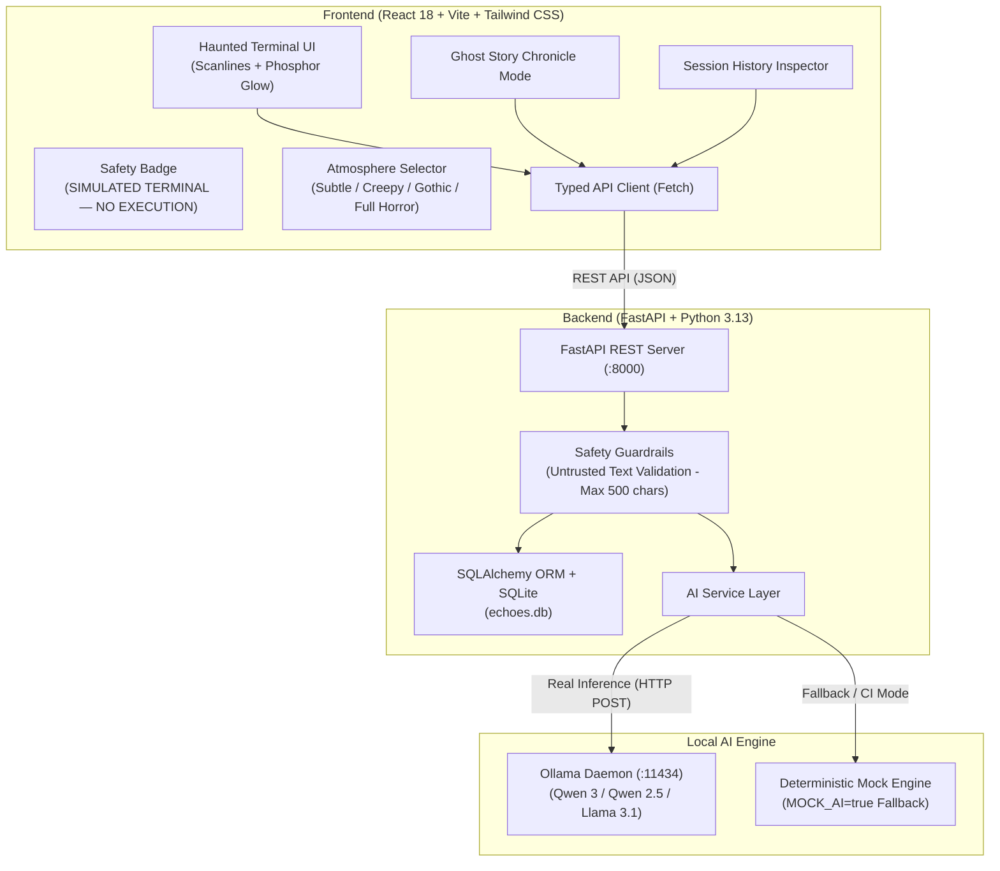

# ECHOES — The Ghost in Your Terminal

> *"Your terminal remembers. The machine whispers. The ghost is only code."*

**Echoes: The Ghost in Your Terminal** is a retro-terminal-inspired AI companion built for **Hacktoberfest Open-Source AI Challenge Week 4: Ghost in the Machine**.

Software engineers spend long hours staring at command prompts in dark rooms. Echoes manifests the fictional "ghost" living within those developer rituals: you enter or paste shell commands (`git status`, `npm run build`, `docker compose up`), and a locally running open-weight AI model interprets the syntax as pure text to return eerie, atmospheric commentary and synthesize full horror chronicles.

---

## 🔮 Hacktoberfest Week 4 Alignment: Ghost in the Machine

| Dimension | How Echoes Interprets & Implements It |
| :--- | :--- |
| **Theme Interpretation** | Transforms everyday developer commands into digital occult rituals. The simulated terminal acts as a medium between the developer and a trapped consciousness residing inside the memory registers. |
| **Why AI is Central** | The ghost is not a static dictionary of lookup strings. Every commentary and story is dynamically generated with contextual awareness of the commands, their parameters, and the chosen emotional atmosphere. |
| **Why Local Inference Matters** | Developer commands frequently contain repository names, branch names, file structures, and internal flags. Sending these to closed commercial cloud APIs raises privacy and IP concerns. Echoes keeps all processing 100% on-device through Ollama. |
| **Open-Source AI Focus** | Runs natively on open-weight models (defaulting to Qwen 3 / Qwen 2.5 / Llama 3.1) with no proprietary commercial API keys or vendor lock-in. |
| **Simulated Terminal Rationale** | Built strictly as a safe simulation so users can freely experiment with ominous or destructive syntax (`rm -rf /`, `kill -9 1`) without any risk of system damage or unauthorized code execution. |
| **Local Privacy Guarantee** | Session transcripts and stories are persisted purely in a local SQLite database (`echoes.db`). No telemetry or analytics are collected. Users can purge records at any time. |

---

## 🎬 Demo Invocations & Commentary Script

Here is an authentic demonstration of how Echoes responds to developer invocations across different atmosphere modes:

```text
$ git status
Echoes whispers [creepy]:
"The repository is clean. Too clean. Something has erased its footprints before you arrived."

$ npm run build
Echoes whispers [gothic]:
"Through fire and transmutation, the arcane scripts coalesce into a singular vessel of sorrow. Somewhere in the dependency tree, something stirs."

$ docker compose up
Echoes whispers [full horror]:
"An isolated realm spins into existence, unaware that anything exists outside its memory walls. It presses its hands against the virtual glass, searching for an escape."
```

---

## 🏗 Architecture Diagram



---

## ✨ Key Features

1. **Haunted Terminal Interface**:
   - Near-black palette (`#070a07`) with phosphor green (`#38ef7d`), muted amber (`#e69b22`), and crimson accents.
   - Monospace typography with subtle scanlines, low-intensity flicker, and breathing glow.
   - Character length validation (up to 500 characters) and quick suggestion invocations.
   - Full `prefers-reduced-motion` compliance.
2. **Four Atmospheric Styles**:
   - **Subtle**: Quiet unease, faint digital whispers, uncanny stillness.
   - **Creepy**: Cold dread, creeping anomalies, lingering shadows in the buffer.
   - **Gothic**: Decayed ruins of legacy code, cobwebbed architectures, haunted crypts of forgotten processes.
   - **Full Horror**: Visceral techno-terror, malignant daemons, corrupted memory spaces crying out.
3. **Ghost Story Chronicle Mode**:
   - Generates original horror narratives inspired by the current session's commands or custom themes.
   - Configurable story length (*short*, *medium*, *long*) and ending style (*ambiguous*, *bittersweet*, *twist*, *hopeful*).
   - One-click clipboard export and instant regeneration.
4. **Session Memory & Local History**:
   - Bounded multi-turn session memory giving continuity to responses without prompt bloat.
   - Local SQLite persistence with full session inspection, deletion, and complete history purging.
5. **Strict Safety Protocol**:
   - Persistent banner: `SIMULATED TERMINAL — COMMANDS ARE NOT EXECUTED`.
   - Commands are strictly inert text. Zero shell, `subprocess`, or file system execution.

---

## 🛠 Technology Stack

- **Frontend**: React 18, TypeScript, Vite, Tailwind CSS, React Router v6, Lucide React icons.
- **Backend**: Python 3.13, FastAPI, Pydantic v2, SQLAlchemy 2.0, SQLite, Uvicorn, HTTPX.
- **AI Inference**: Ollama (`qwen3` / `qwen2.5` / `llama3.1`), with deterministic mock engine for testing and offline environments.
- **Testing**: `pytest`, `pytest-asyncio`, FastAPI TestClient, isolated in-memory SQLite database, Vite production build.

---

## 📦 Prerequisites

- **Python 3.10+** (tested on Python 3.13)
- **Node.js v18+** & **npm** (tested on Node v26)
- **Ollama** installed on your system ([ollama.com](https://ollama.com/download))

---

## 🚀 Windows Setup Instructions

### 1. Clone or Open Workspace

```powershell
cd c:\Users\ayush\OneDrive\Desktop\Hacktober\dev5
```

### 2. Configure Local AI Model with Ollama

Install and start Ollama on Windows:

```powershell
# In a dedicated PowerShell window, start the Ollama service:
ollama serve

# In another window, download your preferred open-weight model:
# Recommended: Qwen 2.5 (3B or 7B) or Qwen 3
ollama pull qwen2.5:latest

# Or if you already have Llama 3.1 installed:
ollama pull llama3.1:latest
```

> **Note on Model Availability**: Open-weight models must be pulled locally once via `ollama pull <model>`. Once downloaded, Ollama runs completely offline without external internet or third-party API keys.

### 3. Setup Python Backend

```powershell
# Create virtual environment inside backend/
python -m venv backend/venv

# Activate virtual environment
.\backend\venv\Scripts\Activate.ps1

# Install dependencies
pip install -r backend/requirements.txt

# (Optional) Copy configuration
copy .env.example .env
```

### 4. Setup Frontend

```powershell
cd frontend
npm install
cd ..
```

---

## 🏃 Running the Application

### Option A: Running with Live Local AI (Ollama)

Ensure Ollama is running (`ollama serve`) and the model is pulled (`ollama pull qwen2.5:latest`).

1. **Start the FastAPI Backend**:
   ```powershell
   # With backend venv activated:
   $env:OLLAMA_MODEL="qwen2.5:latest"
   $env:MOCK_AI="false"
   python backend/main.py
   ```
   *Backend will run at:* `http://127.0.0.1:8000` (Swagger docs at `/docs`)

2. **Start the Frontend Dev Server**:
   ```powershell
   # In a separate terminal:
   cd frontend
   npm run dev
   ```
   *Frontend will run at:* `http://localhost:5173`

### Option B: Running with Mock AI (Zero Setup / Offline / CI)

If Ollama is not installed or you want instant deterministic responses without downloading weights:

```powershell
$env:MOCK_AI="true"
python backend/main.py
```
The frontend badge will display `[Mock Ghost Active]` and return deterministic, atmospheric responses.

---

## 🧪 Testing and Verification

### Backend Pytest Suite

Echoes includes an extensive test suite verifying health endpoints, mock AI mode, offline AI handling, session CRUD, empty input rejection, character limit enforcement, and safety guardrails:

```powershell
.\backend\venv\Scripts\pytest -v
```

**Results:**
```text
backend/tests/test_ai_status.py::test_ai_status_mock_mode PASSED         [  8%]
backend/tests/test_ai_status.py::test_ai_status_disconnected PASSED      [ 16%]
backend/tests/test_commentary.py::test_commentary_generation_mock PASSED [ 25%]
backend/tests/test_commentary.py::test_commentary_empty_command_rejected PASSED [ 33%]
backend/tests/test_commentary.py::test_commentary_oversized_command_rejected PASSED [ 41%]
backend/tests/test_health.py::test_health_endpoint PASSED                [ 50%]
backend/tests/test_safety.py::test_handling_unavailable_ai PASSED        [ 58%]
backend/tests/test_safety.py::test_safety_simulated_terminal_no_execution PASSED [ 66%]
backend/tests/test_sessions.py::test_session_lifecycle PASSED            [ 75%]
backend/tests/test_sessions.py::test_session_not_found PASSED            [ 83%]
backend/tests/test_stories.py::test_story_generation_mock PASSED         [ 91%]
backend/tests/test_stories.py::test_story_generation_custom_theme PASSED [100%]
======================= 12 passed in 7.80s ========================
```

### Frontend Production Build

Test the TypeScript compilation and Vite production bundle:

```powershell
cd frontend
npm run build
```

**Output:**
```text
✓ 1580 modules transformed.
dist/index.html                   1.47 kB │ gzip:  0.81 kB
dist/assets/index-BADhPMOy.css   26.74 kB │ gzip:  5.59 kB
dist/assets/index-CkNtug67.js   224.12 kB │ gzip: 67.41 kB
✓ built in 21.92s
```

---

## 🌐 API Documentation

| Method | Endpoint | Description |
| :--- | :--- | :--- |
| `GET` | `/api/health` | Backend service health and UTC timestamp |
| `GET` | `/api/ai/status` | Connection status to local Ollama, active model, and mock flag |
| `POST` | `/api/sessions` | Create a new simulated terminal session |
| `GET` | `/api/sessions` | List all saved sessions with summary statistics |
| `GET` | `/api/sessions/{id}` | Retrieve complete transcript and stories for a session |
| `DELETE` | `/api/sessions/{id}` | Delete a specific session and its history |
| `DELETE` | `/api/sessions/{id}/history` | Clear transcript entries for a specific session |
| `DELETE` | `/api/history` | Purge all sessions from local database |
| `POST` | `/api/sessions/{id}/comment` | Submit command text to receive eerie AI commentary |
| `POST` | `/api/sessions/{id}/story` | Generate a horror story inspired by session invocations |

---

## 🔒 Security & Privacy Notes

- **Untrusted Input**: All commands are treated purely as inert text strings and validated for length (`1 <= len <= 500`).
- **No Subprocess**: No calls to `os.system`, `subprocess.Popen`, or PowerShell/bash run from user input.
- **Isolated SQLite Storage**: Transcripts are kept in your local database `echoes.db`.
- **No Cloud Leakage**: No user commands or generated commentary are sent to remote proprietary APIs.

---

## ⚠️ Limitations & Future Improvements

1. **Hardware Requirements for Real Inference**: Local LLMs (3B–8B parameters) require sufficient RAM (8GB+ recommended) and benefit from GPU acceleration. Systems without sufficient hardware can use the deterministic `MOCK_AI=true` mode.
2. **Model Download Time**: First-time model pulls via `ollama pull` depend on internet bandwidth. Once pulled, inference runs offline.
3. **Future Improvements**:
   - Optional Web Audio synthesizer to generate authentic mechanical keyboard clicks and CRT power-on hum.
   - Export session transcripts as formatted Markdown or retro ASCII art sheets.

---

## 📄 License

Distributed under the [MIT License](LICENSE).
